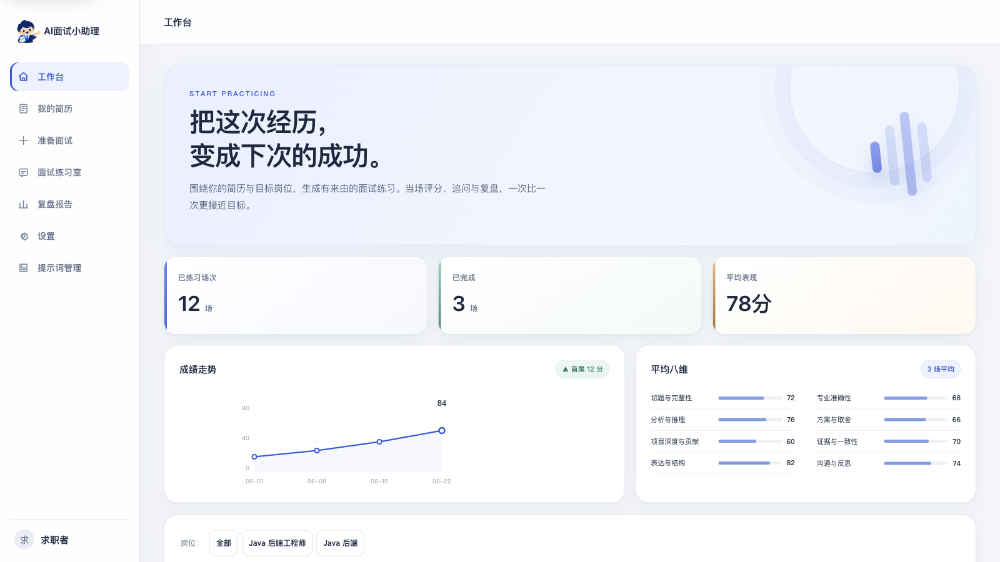
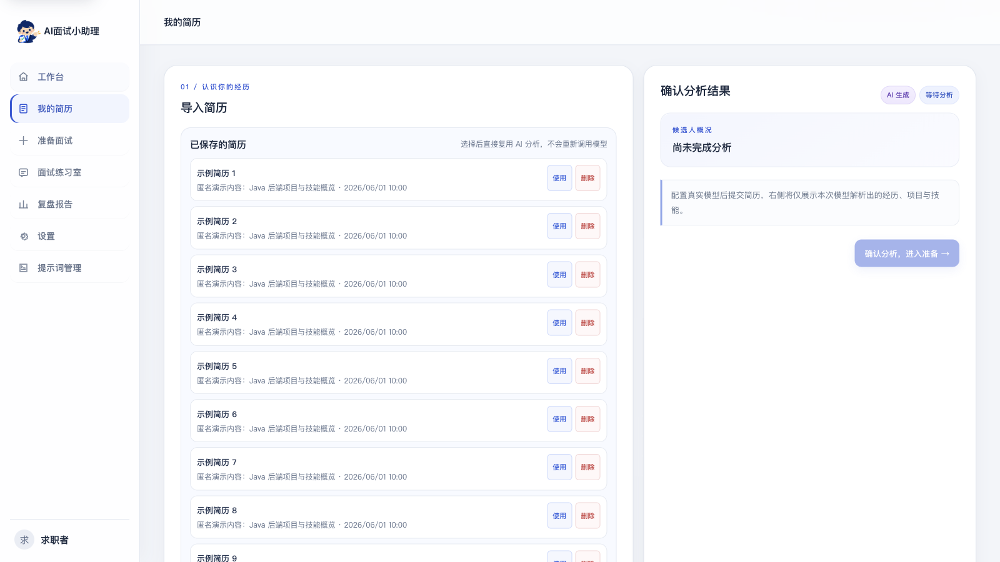
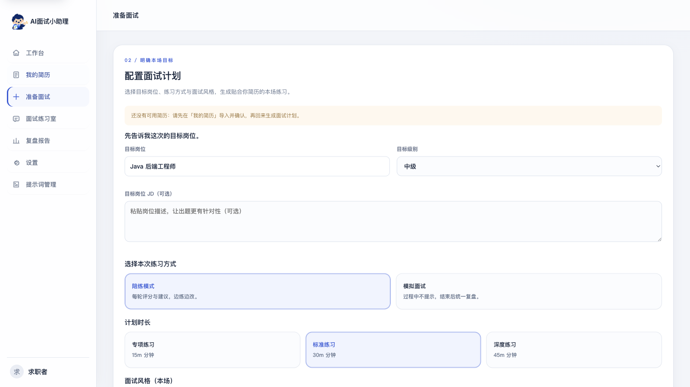
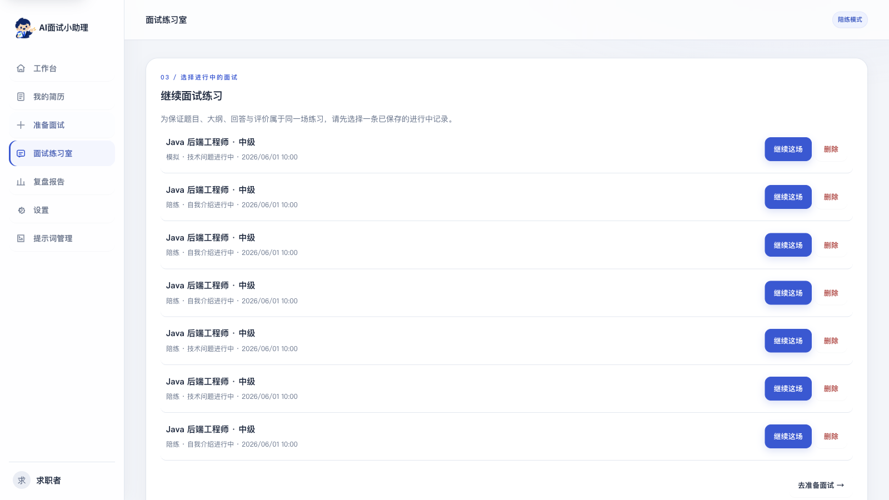
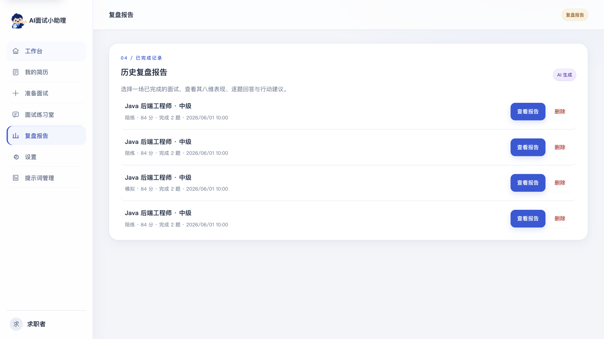
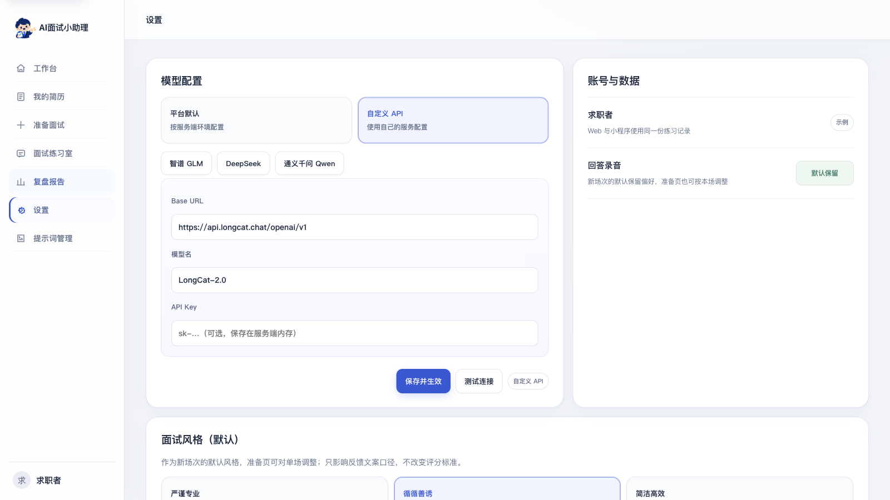
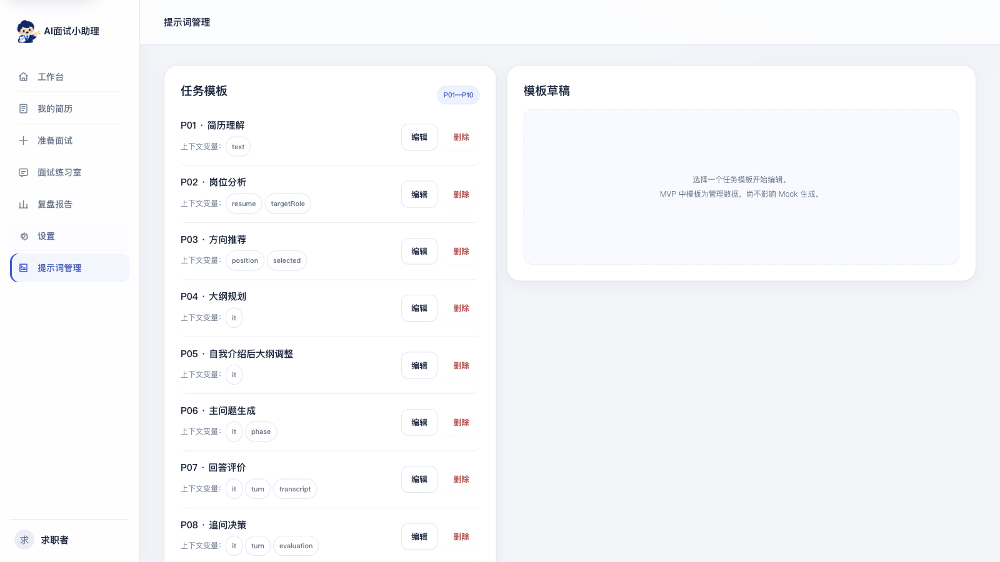

# AI 面试教练

面向 Java 后端求职者的 AI 面试练习工具。围绕简历和目标岗位生成练习方向与面试流程，支持逐题作答、反馈和整场复盘。

**简历 → 岗位与方向 → 面试流程 → 语音或文字练习 → 复盘报告**

本项目为可本地运行的 Web MVP，默认使用 Mock 模型样例；接入兼容 OpenAI Chat Completions 的服务后可切换到真实模型。

## 页面演示

下列截图均由本地 Web 页面在 **1600 × 900（16:9）** 浏览器视口中截取。简历摘要、历史时间和成绩已替换为演示值；设置页的 API Key 已遮罩。练习室与复盘页展示列表入口，不包含单场回答正文。

### 01 · 工作台



查看练习总数、完成数和平均表现；按岗位、模式和状态筛选历史记录，并从列表继续未完成的场次或查看报告。

### 02 · 我的简历



粘贴简历文本或导入支持的文本文件，查看结构化分析结果并选择用于本次面试的简历。截图仅展示简历列表摘要，不展示联系方式。

### 03 · 准备面试



填写目标岗位与级别、可选 JD，选择陪练或模拟面试、计划时长和面试风格；生成考察方向与流程预览后即可开场。

### 04 · 面试练习室



从进行中列表继续练习。场次内逐题展示面试问题，可通过语音或文字作答；陪练模式提供即时评价、建议与追问，模拟模式则在结束后统一复盘。

### 05 · 复盘报告



打开已完成场次查看综合表现、八维评分、逐题反馈和后续行动建议；支持导出 Markdown 报告。截图仅展示历史报告列表。

### 06 · 设置



选择平台默认模型或配置兼容服务的 Base URL、模型名和 API Key；设置新场次的录音保留偏好与默认面试风格。密钥只以遮罩形式显示。

### 07 · 提示词管理



管理员可查看 P01–P10 任务模板、上下文变量，并通过草稿、测试、发布和回滚维护提示词版本。当前为 MVP 管理入口，正式部署前需补齐服务端身份与权限控制。

## 快速开始

环境要求：Node.js 20 或更高版本、pnpm（项目声明版本 12.4.2）。

```bash
pnpm install
```

分别在两个终端启动服务：

```bash
# 后端 API（默认端口 3000）
pnpm --filter @ai-interviewer/server start
```

```bash
# Web 前端（默认端口 5173）
pnpm --filter @ai-interviewer/web dev -- --host 0.0.0.0
```

打开 <http://localhost:5173>。未配置模型服务时，应用使用 Mock 样例完成主要练习流程。

## 配置真实模型

模型服务需提供兼容 OpenAI Chat Completions 的接口。选择一种方式配置：

- 复制 `.env.example` 为 `.env`，填写 `AI_BASE_URL`、`AI_MODEL`、`AI_API_KEY` 后启动后端；或
- 在 Web「设置 → 模型配置」中选择厂商预设或填写自定义连接信息，保存后运行期切换。

可选设置 `DATA_FILE` 启用 JSON 文件持久化；未配置时数据仅保存在服务进程内，重启后清空。浏览器录音功能还需要用户授予麦克风权限，并受浏览器语音识别能力影响。

## 技术栈

| 模块 | 技术 |
| --- | --- |
| Web | React 19、TypeScript、Vite、TanStack Query |
| API | NestJS 11、Fastify |
| 共享契约 | Zod、TypeScript workspace packages |
| 测试 | Vitest、Supertest、端到端冒烟脚本 |
| 仓库 | pnpm workspace：`apps/web`、`apps/server`、`packages/contracts` |

## 测试与校验

```bash
pnpm typecheck
pnpm test
pnpm --filter @ai-interviewer/web run build
```

启动后端后运行端到端冒烟检查：

```bash
pnpm smoke:e2e
```

## 安全与当前边界

- **不要提交密钥或用户资料。** `.env`、`.data/` 等本地配置由 `.gitignore` 排除；提交前仍应检查暂存差异。
- 设置页填写的模型密钥保存在本地服务端配置中；请勿将 `.data/model-config.json` 或真实简历、录音、报告截图加入版本库。
- MVP 不提供真实的登录与管理员授权；提示词管理页面不应直接暴露到公开生产环境。
- 未设置 `DATA_FILE` 时，服务重启会清空内存数据；语音能力依赖浏览器权限与支持情况。
- 当前聚焦 Java 后端面试训练，完整实时语音对话、代码执行题和小程序端不在本 MVP 范围内。

## 进一步阅读

- [需求与决策记录](docs/requirements.md)
- [系统架构](docs/system-architecture.md)
- [接口与数据模型](docs/interface-and-data-model.md)
- [API 规范](docs/api-spec.md)
- [输出 Schema 与评分口径](docs/output-schemas.md)
- [提示词管理说明](docs/prompt-management.md)
- [开发与验收规范](docs/dev-standard.md)
- [外部集成清单](docs/external-integrations.md)
